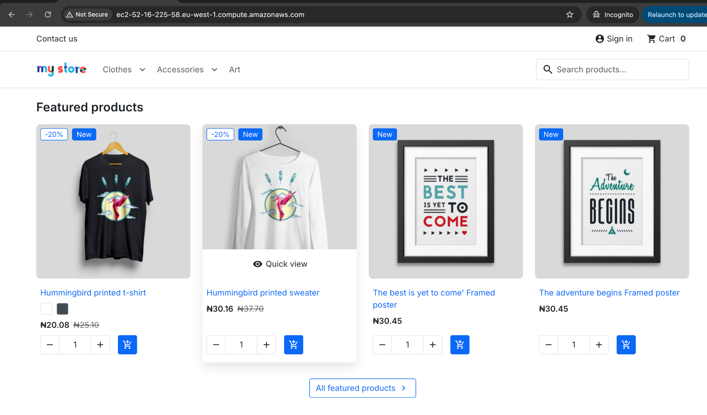
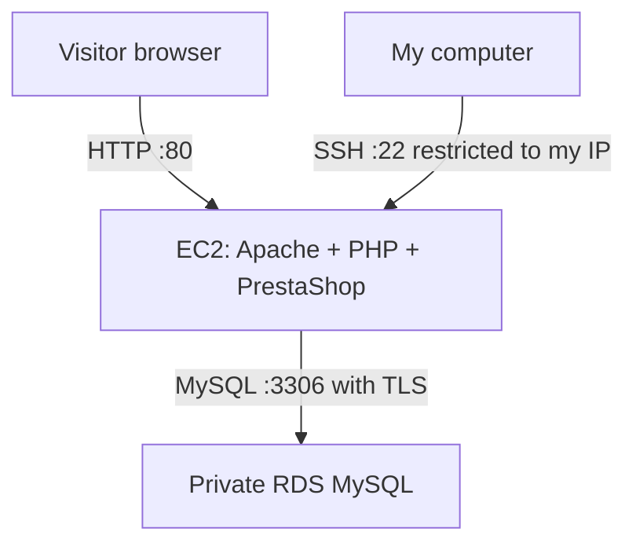
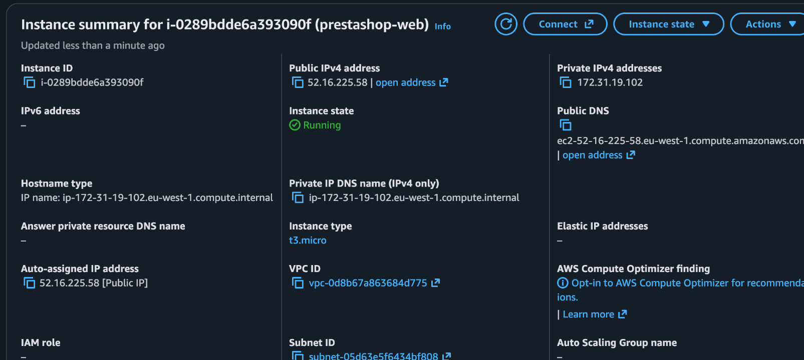
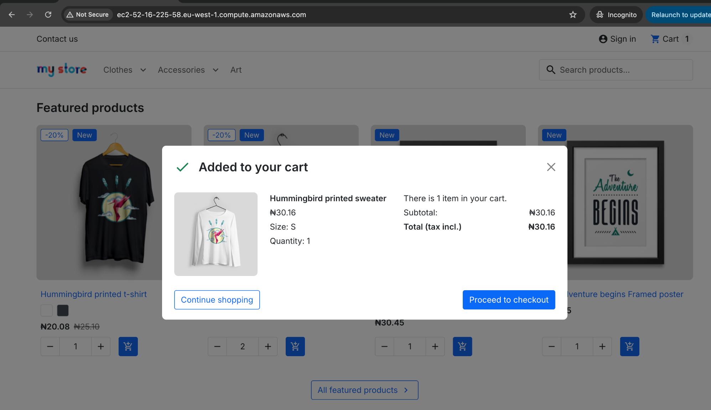

# CloudCart — PrestaShop on AWS

### My hands-on AWS deployment with a separate MySQL database

I deployed PrestaShop on a new Ubuntu EC2 instance and connected it to a private Amazon RDS MySQL database. I worked through network access, database permissions, TLS configuration, installation errors and public access until the storefront and shopping cart worked.

**By Hammed Muhideen Akorede · October 2026**

[View the storefront](http://ec2-52-16-225-58.eu-west-1.compute.amazonaws.com/) · [Database setup](docs/database-setup.md) · [Troubleshooting](docs/troubleshooting.md)

> I verified the storefront and add-to-cart flow on 12 October 2026. This is a learning deployment using HTTP. The live link depends on the AWS resources remaining running; the screenshots preserve the completed result.

*My storefront, “CyberAware BY Muhideen”, loading through the EC2 public DNS name.*

## What I built

| Component | My implementation |
| --- | --- |
| Application server | Amazon EC2, Ubuntu 24.04 LTS, t3.micro |
| Web runtime | Apache 2.4, PHP 8.3, PrestaShop 9.2.0 |
| Database server | Separate Amazon RDS MySQL 8.4.9, db.t3.micro |
| Network | Default VPC in eu-west-1 (Ireland), separate web and database security groups |
| Database protection | Public access disabled, application-only network access, dedicated database user requiring TLS |
| Administration | SSH restricted to my IP; SSH tunnel used during installation |
| Hosting address | AWS-provided public DNS name; no purchased domain |

This repository documents my deployment and troubleshooting work. PrestaShop is the open-source application I installed; I did not develop its source code.

## Find an answer quickly

| I want to… | Open |
| --- | --- |
| Follow the deployment from start to finish | [Deployment guide](docs/deployment-guide.md) |
| Create RDS, the database and its application user | [Database setup](docs/database-setup.md) |
| Understand the network and configuration choices | [Architecture and decisions](docs/architecture-and-decisions.md) |
| Fix a connection or installation error | [Troubleshooting](docs/troubleshooting.md) |
| See what worked and what remains | [Validation and limitations](docs/validation.md) |
| Find a configuration example | [Configuration examples](config-examples/) |
| Review all captured evidence | [Screenshot index](docs/screenshots/README.md) |

## How the components connect

The database runs on RDS, not on the EC2 application server. I installed only a MySQL client on EC2 so I could manage and test the remote database.

## My implementation at a glance

### 1. I created the application instance

I launched `prestashop-web` in Ireland using Ubuntu 24.04 and a t3.micro instance. I used the default VPC, enabled a public IPv4 address and configured 20 GiB of gp3 storage. I required IMDSv2 and used my SSH key to connect.

*The running application instance and its public/private network addresses.*

### 2. I created a separate database

I created `prestashop-db` in Amazon RDS, selected MySQL and Single-AZ deployment, and disabled public access. I restricted port 3306 to the application's security group. Inside MySQL, I created the `prestashop` schema and a dedicated `prestashop_app` account with privileges on that schema only.

*My database was provisioned separately with Public access set to No.*

**[See exactly how I created the database and user →](docs/database-setup.md)**

### 3. I prepared Ubuntu and installed PrestaShop

I installed Apache, PHP 8.3 and the required extensions, added 2 GiB of swap for installation headroom, and configured PHP limits. I extracted the PrestaShop package into `/var/www/prestashop`, configured Apache and opened the installer through an SSH tunnel.

### 4. I fixed the database and installer errors

The database connection worked in the MySQL client, but the application still needed its own TLS configuration. I configured both the legacy PDO connection and Doctrine. I also corrected cache permissions and set the MySQL server version in Doctrine.

**[Read the errors, causes and fixes →](docs/troubleshooting.md)**

### 5. I verified the public store and administration

I logged into the administration dashboard, changed the shop domain from the tunnel address to the AWS hostname, and opened the store in an Incognito browser. I confirmed that products loaded and an item could be added to the cart.

*The public AWS URL and successful add-to-cart result.*

## Skills I demonstrated

- Provisioning EC2 and RDS resources and separating application and database hosting.
- Configuring security groups, SSH access and private database connectivity.
- Managing Ubuntu, Apache, PHP and MySQL permissions.
- Diagnosing application-layer TLS and installation failures.
- Testing a deployment and documenting the evidence and its limitations.

## Scope and next improvements

I used the AWS Free plan and selected the Free Tier template during database setup. This does not mean the resources are free indefinitely: account credits, eligibility and usage limits still apply.

The project is a single-instance learning deployment, not a production-ready store. My next improvements are HTTPS, a supported long-term approach to the PDO TLS change, a verified backup/restore exercise, monitoring and infrastructure as code. Payment processing, high availability and load testing were outside this project.

I excluded passwords, private keys and live application secret files. Configuration examples use placeholders; screenshots are selected deployment evidence rather than a complete security audit.

## Documentation coverage

This publication includes the deployment and database guides, configuration examples, troubleshooting notes and 20 screenshots. Six additional captures and the PDF report are not included. The [screenshot index](docs/screenshots/README.md) identifies the omitted captures; their implementation steps remain explained in the guides.
