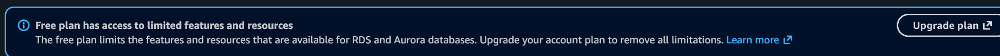

# Architecture and configuration decisions

[Back to the project](../README.md)

| Decision | Why I made it | Trade-off or boundary |
| --- | --- | --- |
| EC2 for the application, RDS for MySQL | Met the separate-database requirement | Two services to configure and monitor |
| Default VPC in Ireland | Kept the lab network simple | Not a custom production network design |
| Public EC2, private RDS | Visitors could reach the store without exposing MySQL publicly | Application access still depends on correct security groups |
| Database SG source = web SG | Limited database network access to the application tier | Screenshot captures do not show every final rule column |
| MySQL application user restricted to EC2 private IP | Limited where that account could authenticate | Replacing the instance may require updating the account host |
| Schema-only privileges and REQUIRE SSL | Avoided using the master account in the application and required encrypted connections | Application clients needed explicit TLS configuration |
| Single-AZ RDS and micro instances | Small learning environment under my selected account plan | No high availability or performance claim |
| 2 GiB swap | Helped the installer on approximately 1 GiB RAM | Slower than RAM; not a scaling strategy |
| Local-only installer plus SSH tunnel | Limited access to the installation endpoint during setup | Tunnel must remain connected |
| AWS public DNS | Avoided buying a domain | Address can change if the public IP changes |
| HTTP storefront | Achieved the assignment's public reachability test | HTTPS remains required before real customer use |

## My intended network rules

| Group | Port | Source |
| --- | --- | --- |
| Web | TCP 22 | My current public IP, `/32` |
| Web | TCP 80 | `0.0.0.0/0` |
| Web | TCP 443 | `0.0.0.0/0`, reserved for future HTTPS |
| Database | TCP 3306 | Web security group |

I corrected the web group's outbound access during setup so the instance could download packages and connect to RDS. An early screenshot still shows the original zero outbound rules.

## Cost choices

I selected the AWS Free plan and RDS Free Tier template. I used modest storage and avoided a load balancer, NAT gateway and purchased domain. I did not treat the plan label as proof of a zero-charge bill or indefinite free usage. Any repeat deployment must fit the account's current credits, eligibility and limits.

## Configuration references

- [Apache virtual host](../config-examples/apache-prestashop.conf)
- [PHP settings](../config-examples/prestashop.ini)
- [Doctrine TLS excerpt](../config-examples/doctrine-tls.example.yml)

These are sanitised examples of my configuration. They contain no private keys, application secret files or working database passwords.
