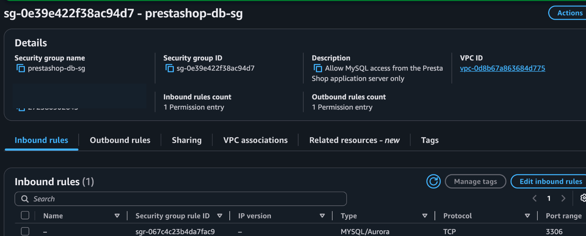
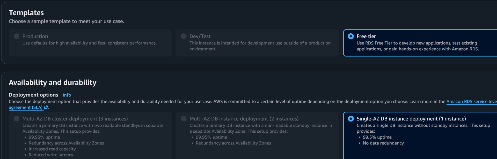
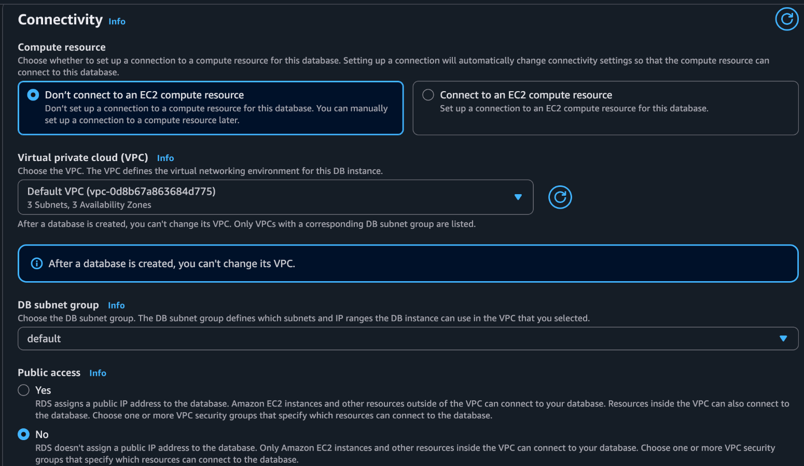
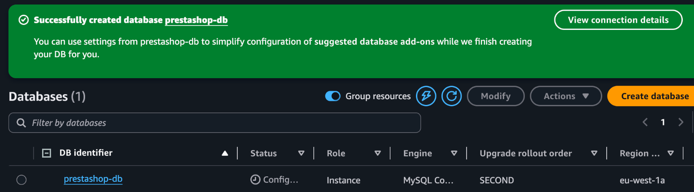
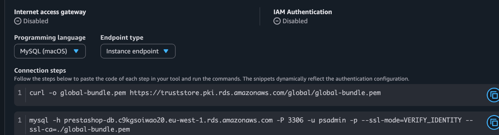

# How I created the database

[Back to the project](../README.md) · [Troubleshooting](troubleshooting.md)

I completed this in two parts: I created a separate **RDS MySQL server**, then created the **PrestaShop database and application user inside MySQL**. The database was never hosted on the EC2 application instance.

## 1. I created the database security group

In the AWS Console, I opened **EC2 → Security Groups → Create security group**. I named the group `prestashop-db-sg` and placed it in the same VPC as my web instance.

I configured an inbound **MySQL/Aurora** rule on TCP **3306**, with `prestashop-web-sg` as the source. This allows the web server to reach MySQL without opening the database port to the internet.


*This capture shows the database group and MySQL rule. The source column is outside the image; the application security group is the source recorded in my setup.*

## 2. I provisioned the RDS server

In **RDS → Databases → Create database**, I used these settings:

| Setting | My selection | Reason |
| --- | --- | --- |
| Engine | MySQL | Database engine for this PrestaShop installation |
| Template | Free Tier | To work within my assignment's account limits |
| Identifier | `prestashop-db` | Clear resource name |
| Availability | Single-AZ | Simple learning deployment |
| Instance class | `db.t3.micro` | My first `db.t4g.micro` choice had an availability/capacity error |
| Storage | 20 GiB gp2 | Separate database storage |
| VPC/subnet group | Default VPC and its subnet group | Same VPC as the application |
| Public access | **No** | Keep the database off the public internet |
| Security group | `prestashop-db-sg` | Allow MySQL from the application group |
| Master username | `psadmin` | Database administration only |
| Initial database name | `prestashop` | Schema for the store |

I chose my own private password and kept it out of this repository. I used the master login for setup, not as the application's permanent login.


*My RDS availability selection.*


*My VPC and private-access choice.*

I created the database and waited for it to become available. The screenshot below captures the earlier successful creation message while configuration was still in progress; later queries confirm that I could connect.



## 3. I copied the endpoint and prepared TLS

I opened the database's **Connectivity & security** details and copied its endpoint. I used the RDS hostname as the database server, not `localhost` or the EC2 public address. The port was **3306**.


*The separate RDS endpoint and AWS's certificate-verifying connection example.*

On EC2, I installed `mysql-client`. I downloaded the AWS RDS CA bundle and placed it at:

`/etc/ssl/certs/aws-rds-global-bundle.pem`

I connected from EC2 with the RDS administrative account, the RDS endpoint and certificate verification enabled. The `-p` option prompted for my password without putting it in the command.

```bash
mysql -h <RDS_ENDPOINT> -P 3306 -u psadmin -p   --ssl-mode=VERIFY_IDENTITY   --ssl-ca=/etc/ssl/certs/aws-rds-global-bundle.pem
```

`<RDS_ENDPOINT>` is a placeholder for the endpoint from the AWS Console. I connected from EC2 because RDS was private and its security group allowed the application server.

## 4. I created the schema and application account

Inside the MySQL prompt, I ensured that the database existed, created a dedicated application user and granted access only to the PrestaShop schema:

```sql
CREATE DATABASE IF NOT EXISTS prestashop
  CHARACTER SET utf8mb4 COLLATE utf8mb4_general_ci;

CREATE USER 'prestashop_app'@'172.31.19.102'
  IDENTIFIED BY '<CHOOSE_YOUR_PRIVATE_PASSWORD>' REQUIRE SSL;

GRANT ALL PRIVILEGES ON prestashop.*
  TO 'prestashop_app'@'172.31.19.102';
```

`172.31.19.102` was my EC2 instance's private IP. For another deployment, I would use that instance's private IP instead. The password is a placeholder, not a credential to copy. `CREATE USER` is a first-time setup step; an existing account should be inspected and updated deliberately instead of recreated.

My decisions were:

- **Schema-level privileges:** the user could work with `prestashop.*`, without global administrative privileges.
- **Host restriction:** the account matched the application's private IP.
- **REQUIRE SSL:** the application had to use an encrypted database connection.
- **Separate accounts:** the RDS master login, application database login and PrestaShop administrator login served different purposes.

## 5. I tested as the application user

I left the administrative session and connected as `prestashop_app`, selecting the `prestashop` database. I used the same CA bundle and `VERIFY_IDENTITY`, then ran:

```sql
SELECT CURRENT_USER(), DATABASE();
```


*The result showed `prestashop_app@172.31.19.102` and `prestashop`.*

This verified the remote endpoint, credentials and selected schema. I then used the application account in the PrestaShop installer.

## 6. I entered the installer database settings

| Installer field | What I entered |
| --- | --- |
| Database server address | My RDS endpoint |
| Database name | `prestashop` |
| Database login | `prestashop_app` |
| Database password | The password I chose for that account |
| Table prefix | The installer's selected prefix |

I did not use `root` or `localhost`. I tested the connection before continuing.

My first application connection failed despite the successful client test. The application needed separate TLS options in its PDO and Doctrine connections. I documented that fix in [Troubleshooting](troubleshooting.md#database-server-is-not-found).

## What I learned

A reachable database is only one part of the setup. The network rule, MySQL account host, schema permissions, password and application TLS options all have to agree. Testing with the MySQL client first helped me separate network and account problems from application configuration problems.
