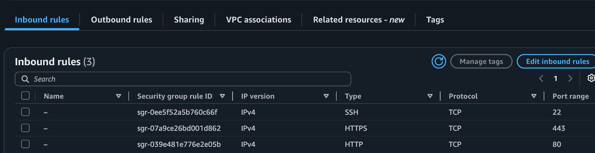
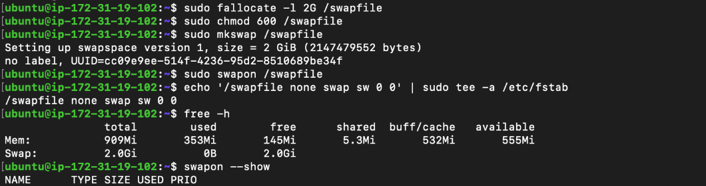
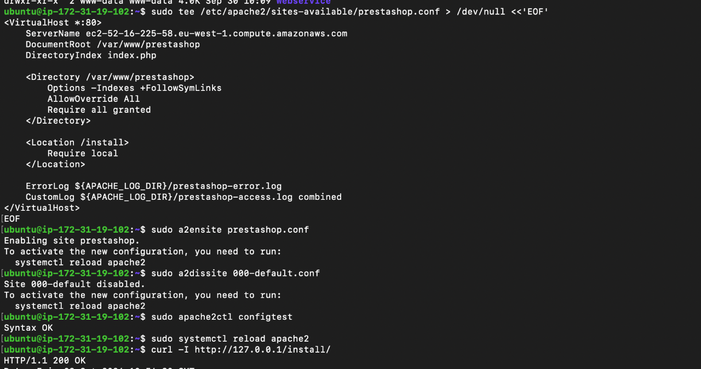
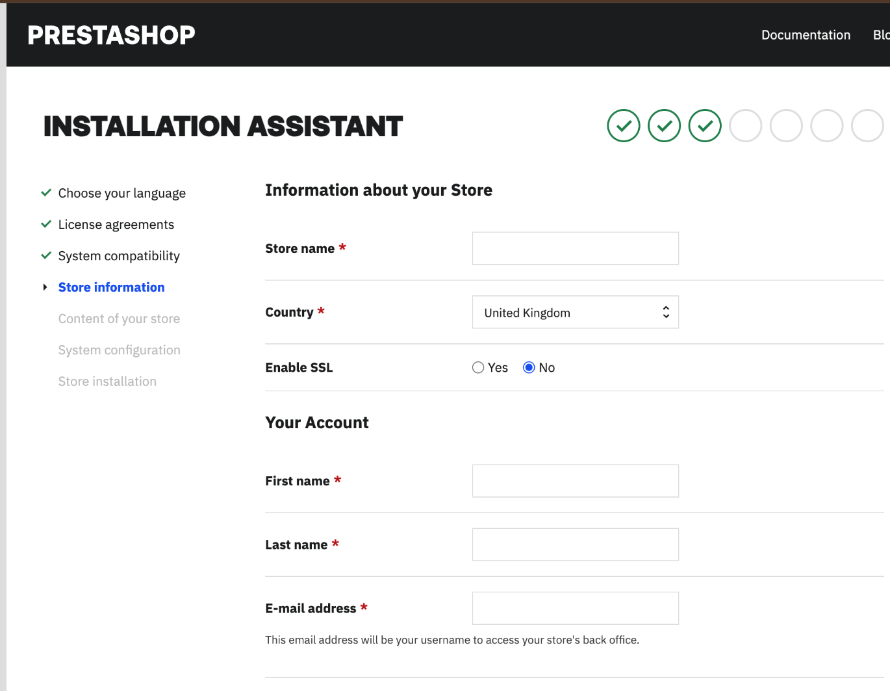

# My deployment process

[Back to the project](../README.md)

This is a record of my October 2026 deployment, organised for reference. Version numbers and AWS account eligibility should be checked before repeating the setup. The PDF contains the fuller command history; this guide focuses on the sequence and decisions.

## 1. Prepare AWS and the network

I selected Ireland (`eu-west-1`) and used the default VPC. I created separate web and database security groups. My web group allowed SSH from my current IP, HTTP for visitors, and port 443 for future HTTPS. Allowing 443 alone did not enable HTTPS. My database group allowed MySQL only from the web group.


*Early inbound-rule capture. Source columns are outside the view; zero outbound rules shown here were corrected later to allow the required outbound connections.*

## 2. Launch the EC2 application server

I created `prestashop-web` with Ubuntu 24.04 LTS, t3.micro, a public IPv4 address, 20 GiB gp3 storage and my SSH key pair. I required IMDSv2 and set CPU credits to Standard during setup.


## 3. Create the separate database

I created a private, Single-AZ RDS MySQL instance and its application schema and user. I used the same VPC so the application could reach the database privately.

**[Follow my complete database creation process →](database-setup.md)**

## 4. Prepare Ubuntu, Apache and PHP

I connected with SSH, updated packages and installed Apache, PHP 8.3 and the required extensions: MySQL, cURL, GD, Intl, Mbstring, XML, ZIP, BCMath and OPcache. I installed the MySQL client, not a MySQL server.

I added a 2 GiB swap file and recorded it in `/etc/fstab`. I configured PHP with a 512M memory limit, 300-second execution/input limits, 20,000 input variables, 64M upload/post limits and the Africa/Lagos timezone.


*The instance had approximately 1 GiB RAM and 2 GiB swap.*

The settings are in [prestashop.ini](../config-examples/prestashop.ini). Swap gave the installer more memory headroom; it did not replace the need for a larger instance under real traffic.

## 5. Deploy the PrestaShop files

I downloaded the official `prestashop_edition_basic_version_9.2.0-6.0.zip` package and copied it from my Mac to EC2. I checked the archive, extracted it and then extracted the nested `prestashop.zip` into `/var/www/prestashop`.


I gave the web service the write access needed during installation. I created an Apache virtual host, enabled rewrite support, enabled the PrestaShop site and disabled the default site. I restricted `/install` to local requests during setup.

See [the Apache example](../config-examples/apache-prestashop.conf). After saving it, my short validation was:

```bash
sudo apache2ctl configtest
sudo systemctl reload apache2
curl -I http://127.0.0.1/install/
```


*The checks returned Syntax OK and HTTP 200.*

## 6. Run the installer through an SSH tunnel

I forwarded port 8080 on my computer to port 80 on EC2 through SSH. With the tunnel running, I opened `http://127.0.0.1:8080/install/` on my computer. This local address was only for setup, not my public submission URL.

I selected English, entered my shop details, selected Nigeria and used the Hummingbird theme with demo products. I chose my own administrator password. For the database step, I used the RDS endpoint and dedicated application login.



I resolved the TLS, Doctrine and cache errors described in [Troubleshooting](troubleshooting.md). The installer then completed.


## 7. Open administration and set the public domain

I opened the generated administration path and signed in with my store administrator account. I kept that path and credentials out of this repository.


In **Shop Parameters → Traffic & SEO → SEO & URLs**, I set the shop domain and SSL-domain fields to the AWS public hostname, without a protocol or port, and used `/` as the base URI. Filling the SSL-domain field did not configure a certificate or turn on HTTPS.

This removed the unwanted redirect back to `127.0.0.1:8080`. I then tested the AWS URL in an Incognito browser and added a product to the cart.

## 8. Record the result

I captured the working storefront, dashboard and cart, and compiled the implementation report (provided separately). My [validation record](validation.md) separates completed tests from work that still needs verification, including installer removal, final permissions and HTTPS.
