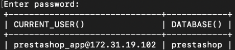
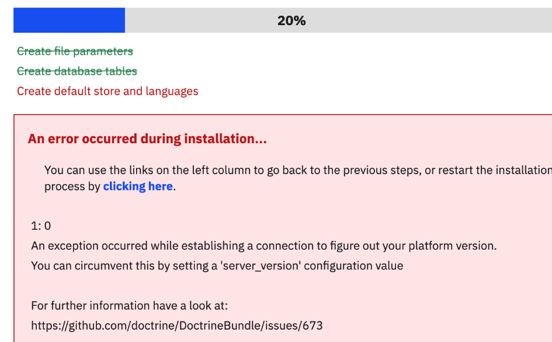
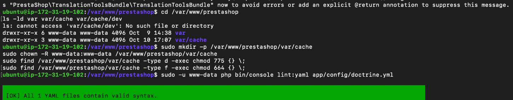

# Problems I encountered and how I fixed them

[Back to the project](../README.md) · [Database setup](database-setup.md)

| Symptom | What I checked or changed | Result |
| --- | --- | --- |
| RDS instance choice unavailable | Changed the initial db.t4g.micro selection to db.t3.micro | Database creation proceeded |
| SSH operation timed out | Checked instance state, current public address and my IP in the SSH rule | Restored SSH access |
| `127.0.0.1:8080/install/` stopped responding | Re-established the SSH tunnel and checked Apache on EC2 | Local installer became reachable |
| Database server not found | Tested remote MySQL login, then configured application TLS | Installer database test passed |
| Installation failed at 20% | Fixed Doctrine TLS settings and server version | Installation could continue |
| Cannot create `var/cache/dev/admin` | Corrected cache ownership and permissions | YAML validation and installation succeeded |
| Store redirected to localhost | Changed the shop domain to the AWS hostname | Public URL loaded the store |

## Database server is not found

**Message:** “Database Server is not found. Please verify the login, password and server fields (DbPDO).”

I checked the RDS endpoint, `prestashop` schema, application username and password. I confirmed that RDS was reachable from EC2 and tested the application login using the MySQL client with certificate and hostname verification.



The client connection worked, which narrowed the issue to the application's connection settings. My database user required SSL, but the legacy PDO connection did not yet supply the required TLS options.

I backed up `classes/db/DbPDO.php` and added these options immediately before the PDO connection was created:

```php
$options[PDO::MYSQL_ATTR_SSL_CA] =
    '/etc/ssl/certs/aws-rds-global-bundle.pem';
$options[PDO::MYSQL_ATTR_SSL_VERIFY_SERVER_CERT] = true;
```

After checking PHP syntax and restarting Apache, the connection test passed.

**Reference lesson:** a successful MySQL client connection does not configure PHP automatically. Each database client needs its own TLS settings. This was a core-file change in my lab; an upgrade may overwrite it, so it needs review before upgrading.

## Installation stopped at 20%

The installer then stopped during database setup with a Doctrine exception.



PrestaShop also used Doctrine, which needed its own configuration. In `app/config/doctrine.yml`, I preserved the existing settings and added the CA path and certificate-verification options to the default connection. I also configured `server_version: '8.4.9'` to match my RDS version.


See [the small Doctrine example](../config-examples/doctrine-tls.example.yml). It is an excerpt to merge into the existing connection, not a replacement for the whole file.

## Cache directory permissions blocked progress

A later error reported that the application could not create `var/cache/dev/admin`. I recreated the required cache path and corrected its ownership for `www-data`, using directory permissions of 775 and file permissions of 664 during setup. I then ran validation as the web-service user.



After correcting the cache permissions, the installer completed all stages.

## The public store redirected to localhost

The installer had been accessed through an SSH tunnel, so `127.0.0.1:8080` was still stored as the shop address. That address refers to the visitor's own computer and is unsuitable for a public storefront.

I changed the shop domain and SSL-domain fields to the EC2 public hostname in **Shop Parameters → Traffic & SEO → SEO & URLs**, and set the base URI to `/`. I opened the AWS URL in an Incognito browser to verify the result.

## Quick diagnostic order I would use again

1. Confirm the instance is running and I am using its current address.
2. Check security-group sources and the required ports.
3. Check Apache locally before diagnosing the browser tunnel.
4. Test the RDS login from EC2 with TLS before changing application code.
5. Check PHP/Doctrine settings and cache permissions.
6. Check the stored shop URL if the public browser redirects incorrectly.

I change one layer at a time and repeat the relevant check, so I can tell which change resolved the problem.
